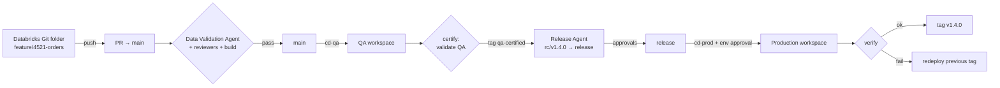

# Agentic CI/CD for Azure Databricks on Azure DevOps

Three agents move code written in **Azure Databricks** from a feature branch to **QA** (`main`) and **production** (`release`) through **Azure DevOps** pull requests — checking the data on the way.

| Agent | What it does | Where it runs |
|---|---|---|
| 🧪 **Data Validation Agent** | Checks the tables a PR touches: **primary key** (declared, not NULL, unique), **completely-NULL columns**, **column-name consistency** (snake_case, glossary abbreviations, duplicates, same concept named differently across tables, type drift) and schema vs. contract. Posts a PR status that branch policies require, plus a report with fixes. | `pr-validation` pipeline → Databricks job |
| 🚀 **QA Promotion Agent** | Opens the PR `feature/* → main` with work items and a generated description, enables auto-complete (squash), reports blockers. After the QA deploy it re-validates QA tables and tags the commit `qa-certified/*`. | `promote-to-qa`, `cd-qa` |
| 🏁 **Release Agent** | Takes the latest QA-certified commit, checks change window/freeze, versions it (SemVer from Conventional Commits), opens `rc/vX.Y.Z → release` with release notes, risk and evidence, waits for human approval. After the prod deploy it verifies, tags `vX.Y.Z`, opens hotfix back-merges, and drives rollback if verification fails. | `release-prepare`, `cd-prod` |

**Design principle:** gates are deterministic and enforced by Azure DevOps branch policies; the LLM (Claude, optional) only writes text — PR descriptions, fix suggestions, release notes — and can make a gate stricter, never looser. See [ADR 0001](docs/adr/0001-deterministic-gates-llm-advisory.md).



## Documentation

* **[High-Level Design](docs/HLD.md)** — goals, architecture, flows, environments, security, NFRs, rollout
* **[Low-Level Design](docs/LLD.md)** — modules, class diagram, rule algorithms, state machines, REST contracts, config, pipelines
* **[ADRs](docs/adr/)** — key decisions and trade-offs
* **[Setup](docs/SETUP.md)** — service principals, service connections, variable groups, branch policies, environments
* **[Runbook](docs/RUNBOOK.md)** — what each failure means and what to do

## Developer workflow

1. Work in a **Databricks Git folder** on `feature/<work-item>-<desc>`; run your pipeline in dev.
2. Run **`notebooks/validate_my_tables.py`** — same rules as the PR gate.
3. Commit & push from the Git folder, then run **`notebooks/promote_to_qa.py`** (or queue `promote-to-qa`).
4. Address review comments / validation findings on the PR. Azure DevOps merges it automatically when every policy passes; `cd-qa` deploys and certifies.
5. Release managers run `release-prepare` (or the weekly train does) and approve the release PR and the production environment.

## Repository layout

```
src/agentic_devops/      agents, rule engine, Azure DevOps + Databricks clients, CLI
contracts/               data contracts: primary key, columns, owners, source paths
config/                  agentic.yml (system config), naming_standards.yml (glossary)
pipelines/               Azure Pipelines: pr-validation, promote-to-qa, cd-qa, release-prepare, cd-prod
databricks.yml resources/ Databricks Asset Bundle: validation job, ops schema & volume
notebooks/               validate_my_tables, promote_to_qa, setup_ops_tables
docs/                    HLD, LLD, ADRs, setup, runbook
tests/                   79 tests (rules, engine, agent flows, REST contracts, LLM guardrails)
```

## Add a table

```yaml
# contracts/sales/orders.yml
table: sales.orders
owner: sales-data-team
primary_key: [order_id]
sources: [src/pipelines/sales/orders/**]
columns:
  - {name: order_id, type: bigint, nullable: false}
  - {name: discount_code, type: string, allow_fully_null: true}
validation:
  filter: "order_date >= date_sub(current_date(), 400)"
  min_rows: 1
```

## CLI

```bash
pip install -e ".[dev,azure,llm]"
agentic-devops validate --pr-id 123              # PR gate
agentic-devops validate --environment qa --all   # ad hoc
agentic-devops promote-qa --source-branch feature/4521-orders-dedupe
agentic-devops certify-qa --commit <sha>
agentic-devops release-prepare [--commit <sha>] [--bump auto|patch|minor|major]
agentic-devops release-finalize --commit <sha>
agentic-devops rollback-target
agentic-devops --dry-run <command>               # plan only, no writes
```

## Development

```bash
pip install -e ".[dev]"
ruff check src tests && ruff format --check src tests
pytest -q
```
