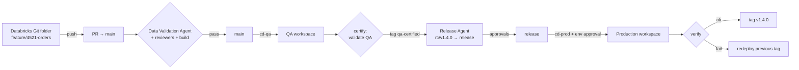

# Agentic CI/CD for Azure Databricks on Azure DevOps

Three agents move code written in **Azure Databricks** from a feature branch to **QA** (`main`) and **production** (`release`) through **Azure DevOps** pull requests — checking the data on the way. Agents are **LangGraph** workflows; language tasks use **LangChain** chat models served from **Azure AI Foundry**, and you choose the model per task in config.

| Agent | What it does | Where it runs |
|---|---|---|
| 🧪 **Data Validation Agent** | Checks the tables a PR touches: **primary key** (declared, not NULL, unique), **completely-NULL columns**, **column-name consistency** (snake_case, glossary abbreviations, duplicates, same concept named differently across tables, type drift) and schema vs. contract. Posts a PR status that branch policies require, plus a report with fixes from a tool-using remediation sub-agent. | `pr-validation` pipeline → Databricks job |
| 🚀 **QA Promotion Agent** | Opens the PR `feature/* → main` with work items and a generated description, enables auto-complete (squash), reports blockers. After the QA deploy it re-validates QA tables and tags the commit `qa-certified/*`. | `promote-to-qa`, `cd-qa` |
| 🏁 **Release Agent** | Takes the latest QA-certified commit, checks change window/freeze, versions it (SemVer from Conventional Commits), opens `rc/vX.Y.Z → release` with release notes, risk and evidence, waits for human approval. After the prod deploy it verifies, tags `vX.Y.Z`, opens hotfix back-merges, and drives rollback if verification fails. | `release-prepare`, `cd-prod` |

**Design principle:** gates are deterministic and enforced by Azure DevOps branch policies. Graph routing is plain Python; models only write text (PR descriptions, fix suggestions, release notes) and can make a gate stricter, never looser. See [ADR 0001](docs/adr/0001-deterministic-gates-llm-advisory.md) and [ADR 0005](docs/adr/0005-langgraph-langchain-foundry.md).



## Switch models (Azure AI Foundry)

```yaml
# config/agentic.yml
llm:
  enabled: true
  project_endpoint: https://<resource>.services.ai.azure.com/api/projects/<project>   # Entra ID auth
  models:
    claude:   {kind: foundry_anthropic, deployment: claude-opus-5-5}
    gpt:      {kind: foundry_openai,    deployment: gpt-4.1}
    gpt-mini: {kind: foundry_openai,    deployment: gpt-4.1-mini}
    mistral:  {kind: foundry_openai,    deployment: Mistral-Large-2411}
  tasks:
    remediation:        {model: claude,   fallbacks: [gpt], use_tools: true}
    pr_description:     {model: gpt-mini, fallbacks: [gpt]}
    release_assessment: {model: claude,   fallbacks: [gpt]}
```

Change one name (or set `LLM_REMEDIATION_MODEL=mistral` in the variable group) to move a task to another model. `agentic-devops models --check` pings every deployment. With `llm.enabled: false` everything still works using templates.

## Documentation

* **[Delivery plan](docs/PLAN.md)** — workstreams, 8-week timeline, backlog, model evaluation, RACI, KPIs, risks
* **[High-Level Design](docs/HLD.md)** — goals, architecture, LangGraph/Foundry runtime, flows, security, NFRs
* **[Low-Level Design](docs/LLD.md)** — modules, rule algorithms, graph mechanics, model registry, REST contracts, config
* **[Agent graphs](docs/GRAPHS.md)** — LangGraph flows rendered from code (`agentic-devops graph`)
* **[ADRs](docs/adr/)** — key decisions and trade-offs
* **[Setup](docs/SETUP.md)** — service principals, Foundry project + RBAC, service connections, branch policies
* **[Runbook](docs/RUNBOOK.md)** — what each failure means and what to do

## Developer workflow

1. Work in a **Databricks Git folder** on `feature/<work-item>-<desc>`; run your pipeline in dev.
2. Run **`notebooks/validate_my_tables.py`** — same rules as the PR gate.
3. Commit & push from the Git folder, then run **`notebooks/promote_to_qa.py`** (or queue `promote-to-qa`).
4. Address review comments / validation findings on the PR. Azure DevOps merges it automatically when every policy passes; `cd-qa` deploys and certifies.
5. Release managers run `release-prepare` (or the weekly train does) and approve the release PR and the production environment.

## Repository layout

```
src/agentic_devops/agents/   LangGraph agent flows (validation, QA promotion, release)
src/agentic_devops/llm/      LangChain + Azure AI Foundry: model registry, advisor, remediation sub-agent
src/agentic_devops/core/     flow builder, supervisor graph, policies, audit, factory
src/agentic_devops/validation/  rule engine (PK, nulls, naming, schema), Spark/pandas backends, Databricks job
src/agentic_devops/integrations/ Azure DevOps, Databricks, Teams clients
contracts/                   data contracts: primary key, columns, owners, source paths
config/                      agentic.yml (system + model routing), naming_standards.yml (glossary)
pipelines/                   Azure Pipelines: pr-validation, promote-to-qa, cd-qa, release-prepare, cd-prod
databricks.yml resources/    Databricks Asset Bundle: validation job, ops schema & volume
notebooks/                   validate_my_tables, promote_to_qa, setup_ops_tables
docs/                        plan, HLD, LLD, graphs, ADRs, setup, runbook
tests/                       88 tests (rules, engine, agent flows, graphs, REST contracts, LLM layer)
```

## CLI

```bash
pip install -e ".[agents,foundry]"               # + azure-identity; [tracing] for App Insights
agentic-devops validate --pr-id 123              # PR gate
agentic-devops validate --environment qa --all   # ad hoc
agentic-devops promote-qa --source-branch feature/4521-orders-dedupe
agentic-devops certify-qa --commit <sha>
agentic-devops release-prepare [--commit <sha>] [--bump auto|patch|minor|major]
agentic-devops release-finalize --commit <sha>
agentic-devops rollback-target
agentic-devops graph [--name release-preparation]  # Mermaid of the LangGraph flows
agentic-devops models [--check]                  # task -> Foundry deployment routing
agentic-devops --dry-run <command>               # plan only, no writes
```

## Development

```bash
pip install -e ".[dev,foundry]"
ruff check src tests && ruff format --check src tests
pytest -q
```
