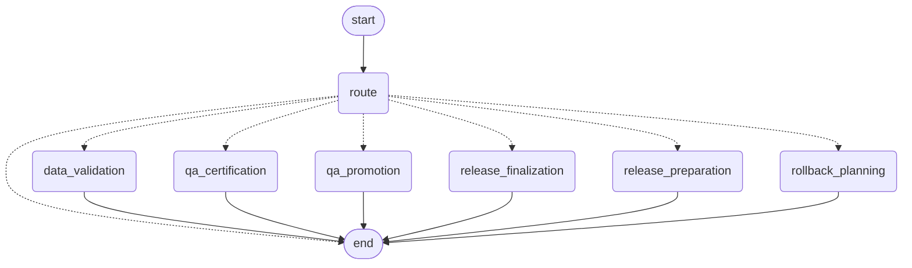
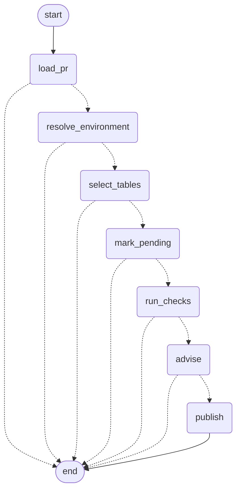
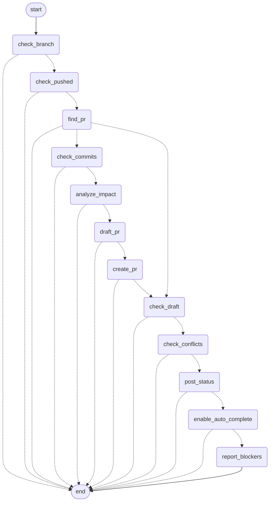
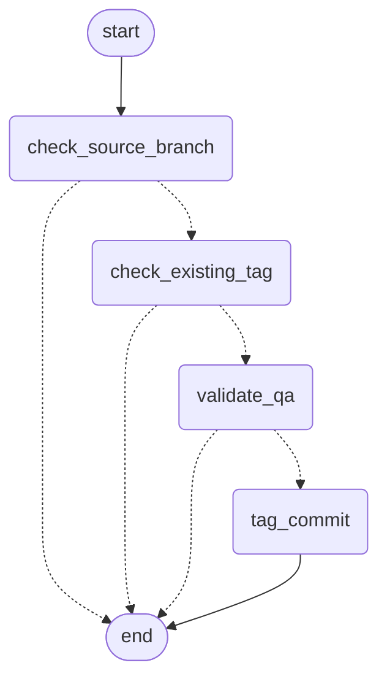
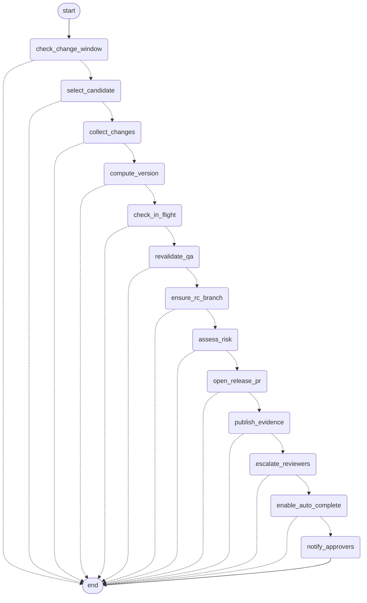
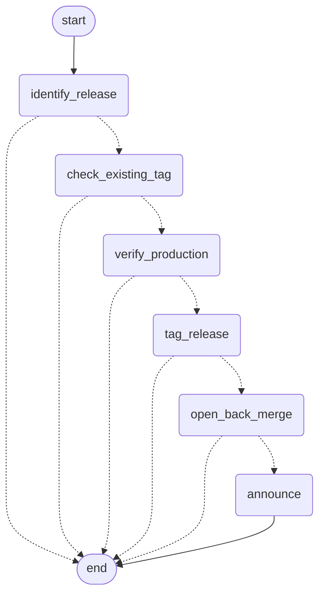

# Agent graphs (generated)

Generated from the compiled LangGraph graphs with `agentic-devops graph`; do not edit by hand.
Dotted edges are conditional. Every step has a dotted edge to `end`: any step can finish the flow
(guardrail blocked, nothing to do, failure, or the final result). Routing is plain Python, never an LLM decision.

## supervisor

Routes CLI commands and Azure DevOps service-hook events to an agent. Deterministic routing.

## data-validation

PR gate: primary key, fully-NULL columns, column naming, schema contract. `advise` is the only LLM step.

## qa-promotion

feature/* → main. `find_pr` branches: reuse the open PR, or check commits → draft (LLM) → create.

## qa-certification

After `databricks bundle deploy -t qa`: validate QA tables, tag `qa-certified/*`.

## release-preparation

Certified commit → rc/vX.Y.Z → PR into release. `assess_risk` is the only LLM step and can only raise risk.

## release-finalization

After `databricks bundle deploy -t prod`: verify, tag vX.Y.Z, hotfix back-merge.

