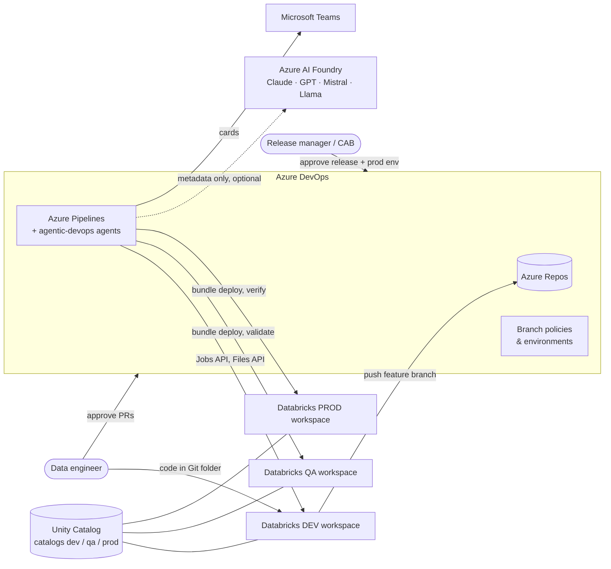
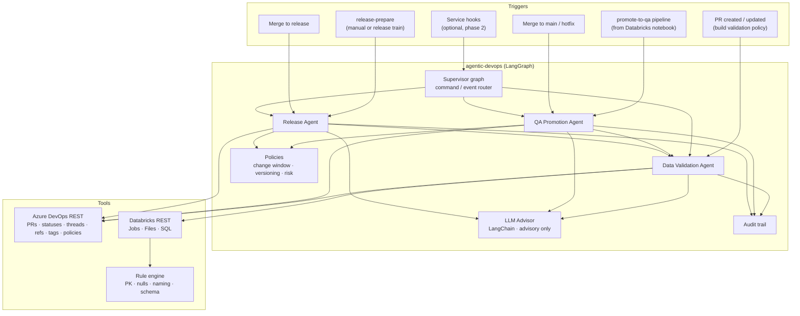
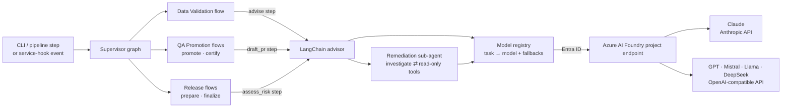
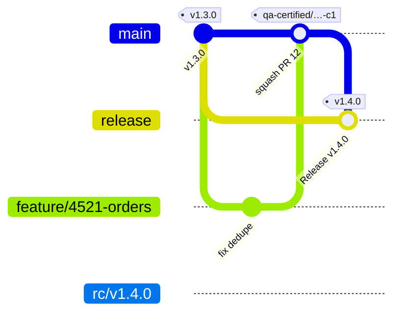
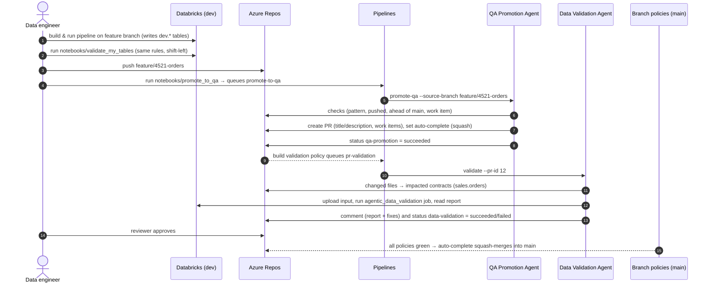
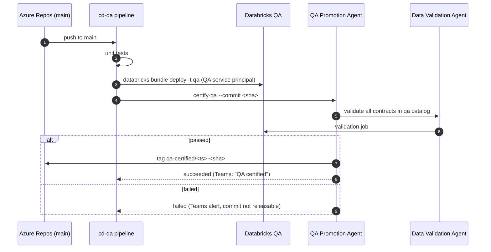
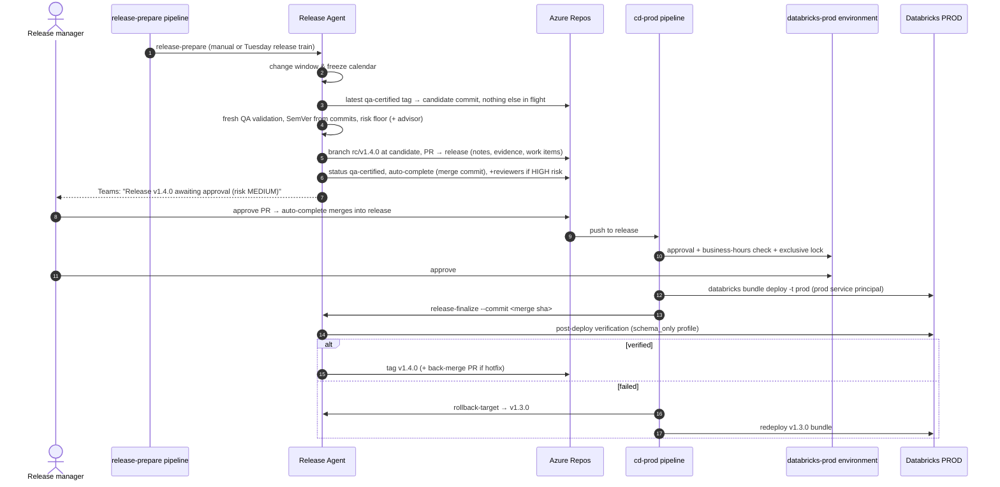
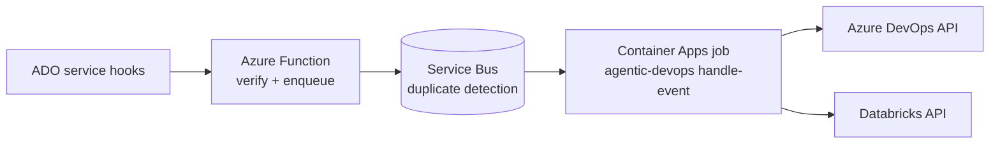

# High-Level Design — Agentic CI/CD for Azure Databricks on Azure DevOps

| | |
|---|---|
| **Status** | Proposed v1.0 |
| **Scope** | Code written in Azure Databricks → PR in Azure DevOps → `main` (QA workspace) → `release` (production workspace) |
| **Agent framework** | LangGraph (workflows) + LangChain (models) on Azure AI Foundry |
| **Companion docs** | [Plan](PLAN.md) · [LLD](LLD.md) · [Graphs](GRAPHS.md) · [ADRs](adr/) · [Setup](SETUP.md) · [Runbook](RUNBOOK.md) |

---

## 1. Problem

Data engineers build pipelines in Azure Databricks (Git folders backed by Azure Repos) and promote them by hand-made PRs. Today:

* Bad data reaches QA and production: **duplicate or NULL primary keys**, **columns that are entirely NULL** (broken joins / mappings), and **inconsistent column names** (`CustID`, `cust_id`, `customer_id` for the same thing) that break downstream joins and BI models.
* Promotion is manual and inconsistent: PRs without work items, wrong merge strategy, no evidence of what was validated, ad-hoc releases outside change windows.
* There is no audit trail linking a production deployment to the checks that justified it.

## 2. Goals and non-goals

**Goals**

1. A **Data Validation Agent** that checks primary keys, fully-NULL columns and column-name consistency on every PR and blocks the merge when they fail.
2. A **QA Promotion Agent** that moves a feature branch into `main` (deployed to the QA workspace) through a PR with all gates applied, then certifies the QA deployment.
3. A **Release Agent** that moves a *QA-certified* commit into `release` (deployed to production) with versioning, release notes, risk assessment, human approval and rollback.
4. Everything idempotent, auditable and least-privilege; no secrets in code.
5. Developers never leave Databricks for the happy path (validate → push → promote from a notebook).

**Non-goals**

* Replacing human code review or production approval. Agents prepare, check and explain; **people approve**.
* Data-content testing beyond the three check families (business-rule tests, freshness SLAs, anomaly detection). The rule engine is pluggable so these can be added later.
* Running the data pipelines themselves (the bundle deploys jobs; orchestrating them stays with Databricks Workflows).

## 3. Key architecture decisions (summary)

| # | Decision | Why | ADR |
|---|---|---|---|
| 1 | **Deterministic gates, LLM advisory only.** Pass/fail, merges, tags and deployments are decided by code and Azure DevOps policies. An LLM from Azure AI Foundry writes PR descriptions, fix suggestions, release notes and a risk opinion that can only *raise* risk. | Gates must be reproducible and explainable to auditors; LLM output is non-deterministic and could be prompt-injected through PR text. | [0001](adr/0001-deterministic-gates-llm-advisory.md) |
| 2 | **Agents run inside Azure Pipelines** (phase 1); an event-driven host is optional (phase 2). | No new infrastructure; reuses service connections, approvals, logs and artifacts already governed by Azure DevOps. | [0002](adr/0002-pipeline-hosted-agents.md) |
| 3 | **Branch policies are the enforcement point.** Agents publish PR *statuses*; branch policies *require* them. The agent identity cannot bypass policies. | A compromised or buggy agent still cannot merge un-validated code. | [0003](adr/0003-branching-and-promotion.md) |
| 4 | **Validation compute runs in Databricks**, next to the data, as a bundle-deployed job. Only a JSON report leaves the workspace. | Data never leaves Unity Catalog governance; scales with Spark. | [0004](adr/0004-validation-runs-in-databricks.md) |
| 5 | **Data contracts in git** (`contracts/**.yml`) declare PK, columns, nullability and owning code paths. | Reviewable with the code; drives impact analysis (which tables a PR touches). | [0004](adr/0004-validation-runs-in-databricks.md) |
| 6 | **Agents are reconcilers**: observe state → do only the missing steps. | Safe pipeline retries; no duplicate PRs, tags or comments. | [LLD §6](LLD.md#6-agent-design) |
| 7 | **LangGraph for agent workflows, LangChain + Azure AI Foundry for models.** Each agent is a compiled state graph; a supervisor graph routes work; models are LangChain chat models chosen per task from Foundry deployments, with fallbacks. | Switch models (Claude, GPT, Mistral, Llama…) by configuration; inspectable graphs; Entra ID end to end. | [0005](adr/0005-langgraph-langchain-foundry.md) |

## 4. Context

## 5. Logical architecture

### 5.1 Agent runtime: LangGraph + LangChain + Azure AI Foundry

* **Flows are LangGraph state graphs** ([diagrams generated from code](GRAPHS.md)). Each node is one step (check, tool call, publish); conditional edges are plain Python, so every gate decision stays deterministic. Any step can end the flow with a result (blocked, skipped, failed, waiting, succeeded).
* **Models are LangChain chat models** behind a registry. `config/agentic.yml` maps logical names (`claude`, `gpt`, `gpt-mini`, `mistral`) to Foundry deployments and each task to a model plus fallbacks. Changing the model for a task is a one-line config or variable-group change.
* **The remediation sub-agent** is the one place a model drives a loop: it may call read-only tools (data contract, findings, naming glossary, files changed in the PR) for a capped number of rounds, then writes fix suggestions. It cannot change anything.
* **Structured outputs** are Pydantic schemas (`with_structured_output`), so any model returns the same shape; Claude uses native JSON-schema output, other models tool calling.

| Task | Step | Default model → fallback | Output |
|---|---|---|---|
| `remediation` | Data Validation `advise` | `claude` → `gpt` (tools on) | "Advisor notes" with fixes and code in the PR comment |
| `pr_description` | QA Promotion `draft_pr` | `gpt-mini` → `gpt` | PR title (must be a Conventional Commit) and description |
| `release_assessment` | Release `assess_risk` | `claude` → `gpt` | Risk opinion (can only raise the rule-based floor) and release notes |

### 5.2 Agents and responsibilities

| Agent | Goal | Inputs (perception) | Actions (tools) | Guardrails |
|---|---|---|---|---|
| **Data Validation Agent** | Every PR into a protected branch carries a correct `agentic-devops/data-validation` status. | PR, changed files, data contracts, naming standard, tables in the gate's catalog | Run validation job, post PR status (per iteration), upsert one report comment, write report artifact + Delta history | Fails **closed** (cannot run ⇒ `error`, never `succeeded`); LLM text never changes the result |
| **QA Promotion Agent** | Feature branch merged into `main`, deployed to QA, and certified. | Branch, commits, diff, PR state, policy evaluations | Create/reuse PR, link work items, set auto-complete (squash), post `qa-promotion` status, after deploy validate QA + create `qa-certified/*` tag | Only `feature/*`, `bugfix/*`, `hotfix/*`; work item required; never bypasses policies; never approves |
| **Release Agent** | A QA-certified commit merged into `release`, deployed to production, verified and tagged. | Certified tags, release history, commits, diff, change calendar | Version (SemVer), `rc/vX.Y.Z` branch pinned to the certified commit, release PR + evidence, auto-complete (merge commit), add reviewers on HIGH risk, after deploy verify + tag `vX.Y.Z`, hotfix back-merge PR, rollback target | Change window + freeze calendar; one release in flight; only certified commits; LLM can only *raise* risk; humans approve PR **and** prod environment |

### 5.3 What the Data Validation Agent checks

| Family | Checks | Default severity |
|---|---|---|
| **Primary key** | declared in contract · columns exist · no NULL key · no duplicate key (with sample keys and dedupe suggestion) — composite keys supported | error |
| **Fully-NULL columns** | column NULL (or blank string) in every row · NOT NULL contract violation · NULL ratio ≥ 95 % (warning) · empty table / `min_rows` | error / warning |
| **Column naming consistency** | snake_case (whitespace, special chars, camelCase, leading digit…) with suggested name · case-insensitive duplicates · same field spelled two ways in a table · non-standard abbreviations from the glossary (`cust_id` → `customer_id`) · reserved words · max length · type conventions (`is_` for booleans) · **cross-table**: same concept spelled differently across tables, same column with different data types | error / warning / info |
| **Schema contract** | missing columns (detects probable renames) · unexpected columns · type drift vs contract | error / info |

Severities are configurable per rule (`severity_overrides`), and `fail_on_warnings` turns warnings into blockers for teams that want it.

## 6. Environments and branching

| Branch | Deploys to | Unity Catalog | Who merges | Gate highlights |
|---|---|---|---|---|
| `feature/<wi>-<desc>`, `bugfix/*` | Dev workspace (developer runs) | `dev` | developer pushes | — |
| `main` | **QA** workspace (`cd-qa`) | `qa` | Azure DevOps auto-complete | 1+ reviewer, build validation, `data-validation` (dev data), `qa-promotion`, comments resolved, linked work item |
| `rc/vX.Y.Z` | — (pins the certified commit) | — | Release Agent creates | — |
| `release` | **Production** workspace (`cd-prod`) | `prod` | Azure DevOps auto-complete | 2 reviewers incl. Release Managers, build validation, `data-validation` (QA data), `qa-certified`, + `databricks-prod` environment approval |
| `hotfix/*` | QA (`cd-qa`), then production via the normal release path | `qa` → `prod` | as above | must be QA-certified like any release; back-merge PR to `main` is opened automatically |

## 7. End-to-end flows

### 7.1 Developer → QA (`main`)

### 7.2 QA deployment and certification

### 7.3 QA → Production (`release`)

## 8. Deployment architecture

**Phase 1 (recommended start) — pipeline-hosted agents.** Agents are a Python package executed by five YAML pipelines on Microsoft-hosted (or self-hosted, VNet-injected) agents. State lives in Azure DevOps itself (PRs, statuses, tags), so the agents are stateless.

| Pipeline | Trigger | Agent command |
|---|---|---|
| `pr-validation.yml` | build-validation policy on `main` and `release` | `validate --pr-id` |
| `promote-to-qa.yml` | manual / REST from Databricks notebook | `promote-qa` |
| `cd-qa.yml` | push to `main`, `hotfix/*` | deploy, `certify-qa` |
| `release-prepare.yml` | manual / weekly release train | `release-prepare` |
| `cd-prod.yml` | push to `release` | deploy, `release-finalize`, `rollback-target` |

**Phase 2 (optional) — event-driven.** Azure DevOps service hooks → Azure Function (HTTP) → Service Bus queue (duplicate detection on event id) → Container Apps job running `agentic-devops handle-event`. Same package, same idempotent agents; gives sub-minute reactions (e.g. re-validate on every push) without pipeline queue time.

## 9. Security architecture

| Concern | Control |
|---|---|
| Identity — Azure DevOps | Agents use the pipeline's **Build Service** identity (`System.AccessToken`). Repo permissions: *Contribute to pull requests*, *Create branch* (`rc/*` only via branch security), *Create tag*. **Denied**: *Bypass policies when completing PRs*, *Bypass policies when pushing*, *Force push*. |
| Identity — Databricks | One Entra ID service principal per workspace (`sp-agentic-dev/qa/prod`) behind an ARM service connection with **workload identity federation** — no client secrets. Prod SP is usable only by `cd-prod` (pipeline permissions on the service connection). |
| Data access | Validation SP: `USE CATALOG`, `SELECT` on governed schemas, write only to `ops.validation_results` and the `ops.agentic_validation` volume. Data never leaves the workspace — only aggregate counts and up to 5 sample keys in the report. |
| Separation of duties | Merges only via auto-complete after policies; production needs PR approval **and** environment approval by different groups; the agent never votes. |
| Pipeline integrity | Pipelines run YAML from `main`/`release` (`promote-to-qa` is queued against `main` with the branch as a parameter), so a feature branch cannot change the gate that judges it. |
| LLM data handling | Off by default. When on: models in the company's **Azure AI Foundry** project, called with Entra ID (no API keys); the service principals need *Azure AI User* on the project. Only metadata (rule ids, counts, column names, commit subjects) plus — for remediation — files changed in the PR (`share_source_code`); row values excluded unless `share_sample_values: true`; output sanitised (no HTML/images); traces record no prompt content. |
| Prompt injection | PR titles, commits and tool results are treated as untrusted input; the remediation sub-agent has read-only tools limited to the PR's changed files; model output is never executed or used as a decision; an injected title fails the Conventional-Commit check and is replaced by the template. |
| Secrets | Key Vault-linked variable groups; `${VAR}` interpolation in config; nothing in git. |
| Audit | Every agent decision → JSONL artifact on the run + `ops.audit_events` Delta table; PR comments and statuses are a human-readable trail. |

## 10. Non-functional requirements

| NFR | Target / approach |
|---|---|
| **Correctness** | Fail closed on any error; deterministic rules; 88 tests incl. end-to-end agent flows against an Azure DevOps double and scripted LangChain models. |
| **Idempotency** | Each step checks current state first (existing PR, comment marker, tag, `rc/*` branch, auto-complete flag); Databricks `run-now` uses an idempotency token. |
| **Performance** | One Spark aggregation for row count + NULL counts of all columns; one shuffle per PK check; schema rules need no scan. Contract `filter` bounds scans of very large tables. PR gate typically 3–8 min on serverless. |
| **Scalability** | Impact analysis validates only tables touched by the PR; `max_concurrent_runs` on the job; rules are pluggable. |
| **Availability** | Agents are stateless; a failed pipeline is simply re-run. Azure DevOps or Databricks outages block promotion (fail closed) rather than allowing it. |
| **Observability** | Pipeline logs + `##vso` issues, published evidence artifacts, Teams cards, Delta tables for dashboards (pass rate, top failing rules, lead time to prod). |
| **Maintainability** | Typed config, one package, rule/agent interfaces, LLD-documented REST contracts. |

## 11. Failure modes

| Failure | Behaviour |
|---|---|
| Validation job fails / times out | PR status `error`, comment explains, gate stays closed; re-queue build. |
| Bad data in PR | Status `failed`, comment lists findings + fixes; thread stays *active* (also blocks via comment policy). |
| Merge conflicts | `qa-promotion` status `failed` with instructions for the Git folder. |
| QA certification fails | No `qa-certified` tag → commit cannot be released; Teams alert. |
| Release outside window / in freeze | Release Agent `BLOCKED` with the reason; nothing created. |
| Second release requested while one is open | `BLOCKED`, names the open PR. |
| Production verification fails | Not tagged; rollback stage redeploys previous `vX.Y.Z`; Teams alert. Data written by the bad version may need Delta `RESTORE` (runbook). |
| LLM unavailable / refuses / returns junk | Template text is used; gates unaffected. |

## 12. Technology choices

| Area | Choice |
|---|---|
| Language | Python 3.10+ (matches Databricks runtimes) |
| Compute for checks | Databricks serverless jobs, PySpark |
| Deployment of jobs | Databricks Asset Bundles (`databricks.yml`) |
| CI/CD | Azure Pipelines YAML, branch policies, environments |
| Contracts & config | YAML in git |
| Agent framework | LangGraph (state graphs, supervisor, tool loop) |
| LLM abstraction | LangChain chat models, Pydantic structured outputs, `with_fallbacks` |
| Models (optional) | Azure AI Foundry deployments via `langchain-azure-ai` (Claude, GPT, Mistral, Llama, …), Entra ID |
| LLM tracing | OpenTelemetry → Application Insights (`AzureAIOpenTelemetryTracer`) |
| Notifications | Teams Workflows webhook (Adaptive Cards) |
| Audit / history | Delta tables in `ops` schema |

## 13. Risks and mitigations

| Risk | Mitigation |
|---|---|
| Dev data unrepresentative of QA/prod | Second validation on QA data at release PR and certification; contract `filter`/sampling only for scale, never to skip PK checks on new data. |
| Contracts drift from reality | Schema-contract rule flags drift both ways; contract changes raise release risk. |
| Over-blocking frustrates teams | Severity overrides, `allow_fully_null`, shift-left notebook, actionable fix suggestions in every finding. |
| Agent identity over-privileged | Permission matrix in SETUP, denied bypass permissions, separate SP per workspace. |
| LLM cost / data residency / model churn | Off by default; metadata-only; Foundry in-tenant; small model for high-volume tasks; per-task fallbacks from another model family; model choice is config. |

## 14. Rollout plan

See the [delivery plan](PLAN.md): 8 weeks from foundations to the first agent-driven production release, with every gate in shadow mode before it is enforced and models chosen per task by evaluation.
