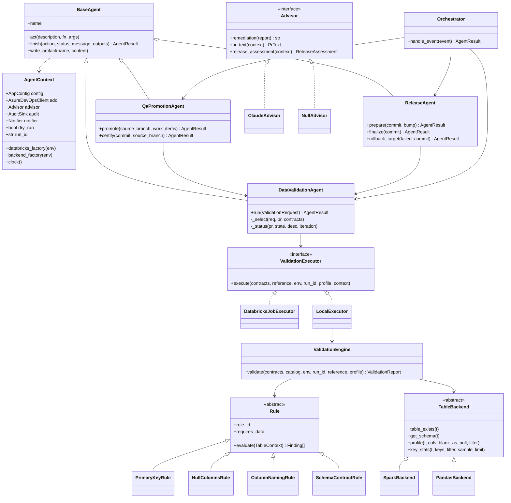
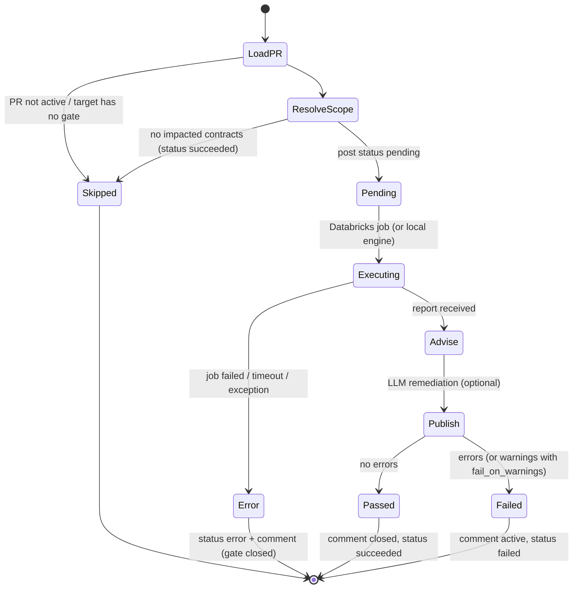
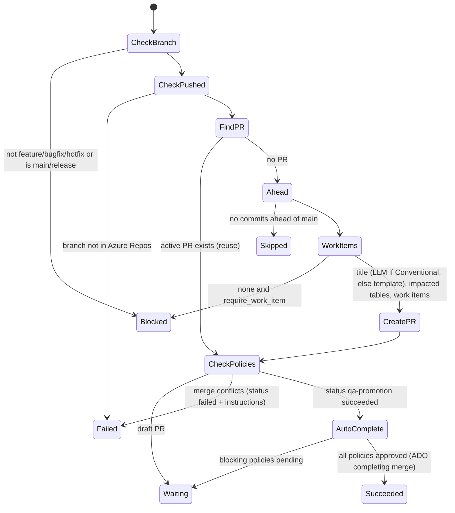
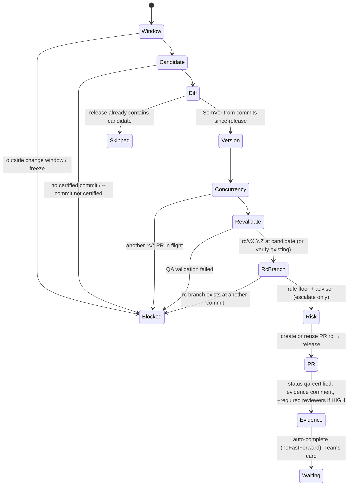

# Low-Level Design — Agentic CI/CD for Azure Databricks on Azure DevOps

Companion to the [HLD](HLD.md). This document describes modules, classes, data contracts, algorithms, state machines, external API contracts, configuration and error handling, as implemented in `src/agentic_devops`.

---

## 1. Repository layout

```
├── src/agentic_devops/
│   ├── cli.py                       # entry point used by pipelines (agentic-devops ...)
│   ├── config.py                    # typed config + ${ENV} interpolation
│   ├── models.py                    # Finding, ValidationReport, AgentResult, enums
│   ├── versioning.py                # SemVer + Conventional Commit bump
│   ├── core/
│   │   ├── agent.py                 # AgentContext, BaseAgent (act / finish / dry-run)
│   │   ├── orchestrator.py          # service-hook event router
│   │   ├── policies.py              # change window, work items, titles, risk floor
│   │   ├── llm.py                   # Advisor protocol, ClaudeAdvisor, NullAdvisor
│   │   ├── audit.py                 # JSONL / Databricks SQL audit sinks
│   │   ├── runtime.py               # ##vso output variables, run URL
│   │   └── factory.py               # wires real clients into agents
│   ├── agents/
│   │   ├── data_validation_agent.py
│   │   ├── qa_promotion_agent.py
│   │   └── release_agent.py
│   ├── integrations/
│   │   ├── http.py                  # retries, backoff, ApiError
│   │   ├── auth.py                  # System.AccessToken / Entra ID / PAT
│   │   ├── azure_devops.py          # Git, PR, statuses, threads, policies, pipelines
│   │   ├── databricks.py            # Jobs 2.1, Files API, SQL statements
│   │   └── notifications.py         # Teams Adaptive Cards
│   └── validation/
│       ├── contracts.py             # DataContract + impact analysis
│       ├── naming.py                # NamingStandards, snake_case, glossary
│       ├── backends.py              # TableBackend: SparkBackend, PandasBackend
│       ├── rules/                   # primary_key, null_columns, column_naming, schema_contract
│       ├── engine.py                # ValidationEngine (profiles, overrides, fail-closed)
│       ├── executors.py             # DatabricksJobExecutor, LocalExecutor
│       ├── report.py                # PR comment markdown
│       └── job.py                   # Databricks python_wheel_task entry point
├── contracts/<domain>/<table>.yml   # data contracts
├── config/agentic.yml               # system config
├── config/naming_standards.yml      # naming glossary
├── databricks.yml, resources/       # Databricks Asset Bundle (validation job, ops schema/volume)
├── pipelines/                       # Azure Pipelines YAML + templates
├── notebooks/                       # developer notebooks (validate, promote, setup)
└── tests/                           # 79 tests, Azure DevOps double, pandas tables
```

## 2. Class diagram



## 3. Data models

### 3.1 Data contract (`contracts/<domain>/<table>.yml`)

| Field | Type | Required | Meaning |
|---|---|---|---|
| `table` | `schema.table` (or `catalog.schema.table`) | yes | Catalog is injected per environment (`dev`/`qa`/`prod`) |
| `primary_key` | list[str] | yes* | Composite keys allowed. *Required when `require_primary_key: true` |
| `columns[]` | `{name, type, nullable, allow_fully_null, description}` | recommended | Drives schema-contract and NOT NULL checks |
| `sources` | list[glob] | recommended | Code paths that write the table → impact analysis |
| `owner` | str | recommended | Team to contact |
| `validation.filter` | Spark SQL predicate | no | Bound scans on very large tables (e.g. last 400 days) |
| `validation.min_rows` | int | no | Minimum rows expected |
| `validation.allow_extra_columns` | bool (default true) | no | `false` ⇒ undeclared columns are errors |

### 3.2 Finding / report

```json
{
  "run_id": "3f2a9c1e0b7d",
  "environment": "dev",
  "catalog": "dev",
  "profile": "full",
  "passed": false,
  "fail_on_warnings": false,
  "started_at": "2026-10-27T06:00:01+00:00",
  "finished_at": "2026-10-27T06:03:12+00:00",
  "tables": [
    {
      "table": "sales.orders",
      "row_count": 1834221,
      "findings": [
        {
          "rule_id": "pk.unique",
          "severity": "error",
          "table": "sales.orders",
          "column": "order_id",
          "message": "42 primary key value(s) are duplicated across 97 row(s) (order_id).",
          "details": {"duplicate_key_groups": 42, "duplicate_rows": 97, "distinct_keys": 1834166,
                      "sample_duplicates": [{"key": {"order_id": 9001}, "count": 4}]},
          "suggestion": "Deduplicate before writing, e.g. ROW_NUMBER() OVER (PARTITION BY order_id ORDER BY updated_at DESC) = 1 ..."
        }
      ]
    }
  ],
  "cross_table_findings": []
}
```

`passed = errors == 0 and not (fail_on_warnings and warnings > 0)`.

### 3.3 Agent result (CLI stdout, audit `details`, pipeline output variables)

```json
{"agent": "release-agent", "action": "prepare", "status": "waiting",
 "message": "Release PR !231 for v1.4.0 is waiting for approval (risk medium).",
 "outputs": {"pr_id": 231, "pr_url": "...", "commit": "c0ffee...", "version": "1.4.0", "risk": "medium",
             "risk_factors": ["1 data contract(s) changed: contracts/sales/orders.yml"], "rc_branch": "rc/v1.4.0"},
 "planned_actions": ["Create branch rc/v1.4.0 at c0ffee12", "Create release PR rc/v1.4.0 -> release", "..."]}
```

| Status | Exit code | Meaning |
|---|---|---|
| `succeeded` | 0 | Goal reached |
| `waiting` | 0 | Progressing; waiting for humans/policies (not an error) |
| `skipped` | 0 | Nothing to do |
| `blocked` | 1 | A guardrail refused (window, certification, branch pattern…) |
| `failed` | 1 | Validation failed or an action failed |

Scalar outputs are also exported as `##vso[task.setvariable variable=<key>;isOutput=true]` (e.g. `rollback_tag`).

## 4. Validation rules — specification

All rules receive a `TableContext` that lazily caches: physical schema, a single **profile** (row count + NULL count of every column) and **key stats** per key tuple. Rules flagged `requires_data=False` run in the `schema_only` profile (used for post-deploy production verification, no table scans).

### 4.1 Primary key (`PrimaryKeyRule`, requires data)

```
if contract.primary_key empty:  ERROR pk.declared (if require_primary_key)          -> stop
resolve PK columns case-insensitively; missing -> ERROR pk.columns_exist            -> stop
stats = backend.key_stats(table, keys, filter, sample_limit)
if stats.null_key_rows > 0:      ERROR pk.not_null   {null_key_rows, null_counts_by_column}
if stats.duplicate_key_groups:   ERROR pk.unique     {groups, duplicate_rows, distinct_keys, samples[≤5]}
                                  suggestion uses an "updated_at"-like column for ROW_NUMBER ordering
```

Spark implementation (`SparkBackend.key_stats`), 1 scan + 1 shuffle:

```python
null_cond = isNull(k1) | isNull(k2) ...
totals = df.agg(count(1), sum(when(null_cond, 1)))                      # pass 1
dups = df.where(~null_cond).groupBy(keys).agg(count(1).alias("__dup_count"))
         .where("__dup_count > 1").persist(MEMORY_AND_DISK)              # shuffle
agg = dups.agg(count(1), sum("__dup_count"))
samples = dups.orderBy(desc("__dup_count")).limit(n)   # only when duplicates exist
distinct_keys = (rows - null_rows) - (dup_rows - dup_groups)
```

### 4.2 Fully-NULL columns (`NullColumnsRule`, requires data)

| Rule id | Condition | Severity |
|---|---|---|
| `table.min_rows` | `row_count < contract.min_rows` | error |
| `table.empty` | `row_count == 0` (other null checks skipped) | warning |
| `nulls.fully_null_column` | `nulls == row_count` | error; **info** when `allow_fully_null` on the column or in `allow_fully_null_columns` |
| `nulls.not_nullable_violation` | `nullable: false` in contract and `nulls > 0` (PK columns excluded — covered by `pk.not_null`) | error |
| `nulls.high_null_ratio` | `nulls / rows ≥ null_ratio_warn_threshold` (0.95) | warning |

NULL definition: `IS NULL`; for `string` also `trim(col) = ''` when `treat_blank_as_null`; for `double/float` also `isnan(col)`. Computed in **one** aggregation:

```python
df.agg(count(1).alias("__row_count"),
       sum(when(col0.isNull() | (trim(col0) == ""), 1).otherwise(0)).alias("__n0"),
       sum(when(col1.isNull() | isnan(col1), 1).otherwise(0)).alias("__n1"), ...)
```

### 4.3 Column naming (`ColumnNamingRule`, schema only)

| Rule id | Logic | Severity |
|---|---|---|
| `naming.convention` | `^[a-z][a-z0-9]*(_[a-z0-9]+)*$`; message lists reasons (whitespace, special chars, upper case, leading digit, `__`, edge `_`); `suggested_name = canonical_name(name)` | error |
| `naming.max_length` | `len > max_length` (64) | warning |
| `naming.reserved_word` | in `reserved_words` | warning |
| `naming.non_standard_abbreviation` | a token is in the glossary (`cust→customer`, `amt→amount` …) and not in `allowed_tokens` | warning |
| `naming.type_convention` | e.g. boolean must start `is_/has_/…`; timestamp should end `_ts/_at` | per convention |
| `naming.case_insensitive_duplicate` | two columns equal after `lower()` | error |
| `naming.normalized_duplicate` | two columns equal after snake_case + removing `_` (`customer_id` vs `customerid`) | warning |

`canonical_name(name) = join("_", glossary.get(t, t) for t in to_snake_case(name).split("_"))`, where `to_snake_case` splits camelCase/PascalCase, replaces non-alphanumerics, collapses `_`, lower-cases and prefixes `c_` if it starts with a digit.

### 4.4 Cross-table naming (`CrossTableNamingRule`)

Universe = physical columns of tables validated in this run **+** declared columns of every contract in the repo (so a PR touching one table is compared against the whole model).

* `naming.cross_table_inconsistent` (warning): group columns by `canonical_name`; if a group has ≥ 2 spellings, flag each non-canonical spelling in a validated table, listing the other usages (`orders.cust_id` vs `customers.customer_id`).
* `naming.cross_table_type_mismatch` (warning): group by exact name; if normalised types differ (`bigint` vs `string`), flag the validated table's column.

### 4.5 Schema contract (`SchemaContractRule`, schema only)

* `schema.missing_column` (error) — with `possible_rename_of` when a physical column normalises to the same name.
* `schema.type_mismatch` (error) — after normalising aliases (`long→bigint`, `integer→int`, `varchar(n)→string`, whitespace in `decimal(18, 2)`).
* `schema.unexpected_column` — info, or error when `allow_extra_columns: false`.
* `schema.table_not_found` (error) — emitted by the engine.

### 4.6 Engine behaviour

* **Profiles**: `full` (all rules) / `schema_only` (rules with `requires_data=False`).
* **Fail closed**: an exception in a rule or backend becomes `<rule>.execution_error` (error).
* **Severity overrides**: `severity_overrides: {"naming.type_convention": "off", "naming.*": "warning"}` — exact id first, then family wildcard; `off` drops the finding.

## 5. Impact analysis

```
changed = PR iteration changes (paths + originalPath for renames)
if any changed file matches validation.global_impact_paths  -> all contracts
else contract impacted if
     its own YAML changed, or
     any changed file matches one of its `sources` globs (fnmatch, ** crosses directories)
no contract impacted -> status succeeded "No governed tables affected", agent SKIPPED
```

## 6. Agent design

All agents extend `BaseAgent` and follow the **reconcile** pattern: read state from Azure DevOps → compute the missing steps → perform them via `act()` (which records the action and is a no-op under `--dry-run`) → `finish()` (returns `AgentResult` and writes an audit event).

### 6.1 Data Validation Agent — state machine



Request: `ValidationRequest(pr_id, environment, tables, validate_all, profile, commit, post_to_pr)`. Environment defaults to `validation.gate_environments[pr.target_branch]` (`main→dev`, `release→qa`).

### 6.2 QA Promotion Agent — `promote`



### 6.3 QA Promotion Agent — `certify`

1. If `source_branch` given, it must be `main` or match `hotfix_pattern` → else `BLOCKED`.
2. If a `qa-certified/*` tag already points at the commit → `SUCCEEDED` (idempotent).
3. `DataValidationAgent.run(environment=qa, validate_all, profile=certify_profile)`; failed → `FAILED`, Teams error.
4. Annotated tag `qa-certified/<YYYYMMDD-HHMMSS>-<sha8>` (lexically sortable = chronological).

### 6.4 Release Agent — `prepare`



Versioning (`versioning.py`): latest `v<semver>` tag (semantic, not lexical order) → bump: `major` if any `type!:` or `BREAKING CHANGE`, `minor` if any `feat`, else `patch`; first release = `release.initial_version`. Azure DevOps squash messages (`Merged PR 12: feat(...)`) are recognised.

Risk floor (`policies.assess_release_risk`):

| Factor | Level |
|---|---|
| contract YAML changed, bundle/pipeline/resources changed, >15 files, QA warnings | medium |
| shared code (`global_impact_paths`) changed, >50 files or >30 commits | high |
| otherwise | low |

`final_risk = max(rule_floor, advisor_risk)`; on `high`, every id in `release.high_risk_reviewer_ids` is added as a **required** reviewer.

### 6.5 Release Agent — `finalize` and `rollback_target`

`finalize(commit)` (cd-prod, after deploy): find the completed PR into `release` whose `lastMergeCommit == commit` → version from `rc/vX.Y.Z` (or next patch for a direct hotfix PR) → if the tag exists on this commit → `SUCCEEDED`; on another commit → `FAILED` → run validation in `prod` with `verify_profile` (default `schema_only`) → failed: `FAILED` with `rollback_tag` = latest existing release tag → passed: create tag `vX.Y.Z`; if the released candidate has commits missing from `main` (hotfix), open back-merge PR `release → main` (idempotent).

`rollback_target(failed_commit)` returns the highest SemVer tag not pointing at `failed_commit`; the pipeline checks it out and redeploys the bundle.

## 7. Azure DevOps REST contract (api-version 7.1)

Base: `https://dev.azure.com/{org}/{project}/_apis`, repo base `…/git/repositories/{repo}`.

| Purpose | Method & path | Notes |
|---|---|---|
| Agent identity | `GET {org}/_apis/connectionData` | `authenticatedUser.id` for `autoCompleteSetBy` |
| Project id | `GET {org}/_apis/projects/{project}` | for policy artifact id |
| Branch head | `GET …/refs?filter=heads/{branch}` | filter is a **prefix** match → compare names exactly |
| Create branch | `POST …/refs` `[{name, oldObjectId: 0000…, newObjectId}]` | `rc/*` |
| List tags | `GET …/refs?filter=tags/{prefix}&peelTags=true` | commit = `peeledObjectId` for annotated tags |
| Create tag | `POST …/annotatedtags` `{name, taggedObject:{objectId}, message}` | |
| Commits between | `GET …/commits?searchCriteria.itemVersion.version=X&…compareVersion.version=Y` | versionType `branch`/`commit` auto-detected |
| Diff files | `GET …/diffs/commits?baseVersion=…&targetVersion=…&$top=2000&$skip=` | paged until `allChangesIncluded` |
| Find PR | `GET …/pullrequests?searchCriteria.sourceRefName=&targetRefName=&status=active` | |
| Create PR | `POST …/pullrequests` `{sourceRefName, targetRefName, title≤400, description≤4000, workItemRefs:[{id}], isDraft}` | |
| Auto-complete | `PATCH …/pullrequests/{id}` `{autoCompleteSetBy:{id}, completionOptions:{mergeStrategy, deleteSourceBranch, transitionWorkItems, mergeCommitMessage, bypassPolicy:false}}` | `squash` to main, `noFastForward` to release |
| Iterations | `GET …/pullRequests/{id}/iterations` | latest id for statuses/changes |
| Changed files | `GET …/pullRequests/{id}/iterations/{it}/changes?$compareTo=0&$top=2000&$skip=` | paged via `nextSkip/nextTop` |
| PR status | `POST …/pullRequests/{id}/statuses` `{state, description≤250, context:{genre:"agentic-devops", name}, targetUrl, iterationId}` | states: `pending/succeeded/failed/error/notApplicable` |
| Threads | `GET/POST …/pullRequests/{id}/threads`; `PATCH …/threads/{t}/comments/{c}`; `PATCH …/threads/{t}` `{status}` | single thread per marker (`<!-- agentic-devops:… -->`) |
| Reviewer | `PUT …/pullRequests/{id}/reviewers/{reviewerId}` `{vote:0, isRequired:true}` | HIGH risk escalation |
| Policies | `GET …/policy/evaluations?artifactId=vstfs:///CodeReview/CodeReviewId/{projectId}/{prId}` (7.1-preview.1) | report blockers |
| Queue pipeline | `POST …/pipelines/{id}/runs` `{resources.repositories.self.refName, templateParameters}` | used by the Databricks notebook |

### 7.1 PR statuses published

| Context (`genre/name`) | Posted by | Required by policy on | Meaning |
|---|---|---|---|
| `agentic-devops/data-validation` | Data Validation Agent | `main`, `release` | Data checks for tables affected by this iteration |
| `agentic-devops/qa-promotion` | QA Promotion Agent | `main` (recommended) | Branch pattern, work item, no conflicts |
| `agentic-devops/qa-certified` | Release Agent | `release` | Candidate commit carries a `qa-certified/*` tag |

Status policies should use **"Reset status whenever there are new changes"** so a new push invalidates the old result; statuses are posted with `iterationId` for this reason.

## 8. Databricks contract

| Purpose | Call |
|---|---|
| Upload input | `PUT /api/2.0/fs/files/Volumes/{catalog}/ops/agentic_validation/runs/{run_id}/input.json?overwrite=true` |
| Run job | `POST /api/2.1/jobs/run-now` `{job_id, job_parameters:{input_path, output_path}, idempotency_token:"agentic-{run_id}-{profile}"}` |
| Poll | `GET /api/2.1/jobs/runs/get?run_id=` until `life_cycle_state ∈ {TERMINATED, SKIPPED, INTERNAL_ERROR}`; non-`SUCCESS` ⇒ error; timeout ⇒ `POST /runs/cancel` + error |
| Read report | `GET /api/2.0/fs/files/Volumes/…/output.json` |
| Audit insert | `POST /api/2.0/sql/statements` with named parameters (no string interpolation of values) |

Job (`resources/agentic_validation_job.yml`): serverless `python_wheel_task`, entry point `agentic-validation-job` (`validation/job.py`), wheel built by the bundle. Input document:

```json
{"run_id": "...", "environment": "qa", "catalog": "qa", "profile": "full",
 "contracts": [<DataContract.to_dict>], "reference_contracts": [...],
 "validation_config": {...}, "naming_standards": {...},
 "results_table": "qa.ops.validation_results", "context": {"pr_id": 12, "commit": "..."}}
```

The job exits 0 whenever validation **ran**; pass/fail is in the report, so the agent can tell "data is bad" (status `failed`) from "could not validate" (status `error`).

## 9. Delta tables

```sql
CREATE TABLE IF NOT EXISTS {catalog}.ops.validation_results (
  run_id STRING, environment STRING, pr_id STRING, commit STRING, table_name STRING,
  rule_id STRING, severity STRING, column_name STRING, message STRING, details STRING,
  run_passed BOOLEAN, created_at TIMESTAMP
) CLUSTER BY (table_name, created_at);

CREATE TABLE IF NOT EXISTS {catalog}.ops.audit_events (
  event_ts TIMESTAMP, run_id STRING, agent STRING, action STRING, status STRING, message STRING,
  pr_id INT, commit_sha STRING, environment STRING, dry_run BOOLEAN, details STRING
) CLUSTER BY (agent, event_ts);
```

Example dashboard queries: pass rate per week, top failing `rule_id` per owner, lead time `promote-qa → finalize` per version.

## 10. PR comment format

One thread per agent, found by an HTML marker in the first comment and updated in place:

```
<!-- agentic-devops:data-validation -->
## 🤖 Data Validation Agent — ❌ FAILED
Environment: dev (catalog dev) · Run: 3f2a9c1e0b7d · Commit: c0ffee1234 · Pipeline run
2 error(s), 1 warning(s) across 1 table(s).
| Table | Rows | Errors | Warnings | Result |
### ❌ Errors (2)
- sales.orders · order_id · pk.unique — 42 primary key value(s) are duplicated …
    ↳ Fix: Deduplicate before writing, e.g. ROW_NUMBER() OVER (…)
    ↳ Sample duplicate keys: (order_id=9001) ×4, …
### ⚠️ Warnings (1)
### 🧠 Advisor notes   (AI-generated, advisory only)
```

Failing reports leave the thread **active** (blocks via the comment-resolution policy too); passing reports close it. Output is capped at 50 findings per severity and 140k characters.

## 11. LLM advisor

| Task | Input (metadata only) | Output schema (structured outputs) | Used for |
|---|---|---|---|
| `remediation` | findings (≤60) without `sample_duplicates` unless `share_sample_values` | `{summary, actions[{title, detail, language, code}]}` | "Advisor notes" in the validation comment |
| `pr_text` | branch, commit subjects, changed files, impacted tables, work items | `{title, summary, changes[], review_focus[]}` | PR into `main` (title used only if Conventional Commit) |
| `release_assessment` | version, commits, files, rule risk + factors, QA summary | `{risk_level, risk_reasons[], highlights[], data_changes[], rollback_considerations[]}` | Release PR; risk can only escalate |

Request: `client.beta.messages.create(model="claude-opus-5-5", max_tokens=16000, system=…, output_config={"effort":"medium","format":{"type":"json_schema",…}})`. On the Anthropic API the request adds `betas=["server-side-fallback-2026-07-01"], fallbacks="default"`; on Microsoft Foundry the client registers `BetaRefusalFallbackMiddleware([{"model":"claude-opus-4-8"}])` and authenticates with Entra ID (`https://cognitiveservices.azure.com/.default`). `stop_reason` `refusal`/`max_tokens`, exceptions or invalid JSON ⇒ `None` ⇒ template. Prose is sanitised (`<`/`>` escaped, markdown images removed), code fences are neutralised.

## 12. Configuration reference (`config/agentic.yml`)

| Key | Default | Notes |
|---|---|---|
| `azure_devops.organization_url / project / repository` | — | required |
| `azure_devops.status_genre` | `agentic-devops` | genre of all PR statuses |
| `branches.qa / prod` | `main` / `release` | |
| `branches.feature_pattern / hotfix_pattern` | `^(feature\|bugfix)/…$` / `^hotfix/…$` | |
| `branches.release_candidate_prefix` | `rc/` | |
| `branches.qa_certified_tag_prefix` | `qa-certified/` | |
| `environments.<name>.catalog` | — | required |
| `environments.<name>.workspace_url / validation_job_id / volume_path / results_table` | — | from variable groups |
| `validation.execution_mode` | `databricks_job` | or `local` (in-notebook) |
| `validation.gate_environments` | `{main: dev, release: qa}` | |
| `validation.fail_on_warnings` | `false` | |
| `validation.null_ratio_warn_threshold` | `0.95` | |
| `validation.treat_blank_as_null` | `true` | |
| `validation.require_primary_key` | `true` | |
| `validation.global_impact_paths` | `[]` | globs that re-validate everything |
| `validation.severity_overrides` | `{}` | `rule_id` or `family.*` → `error/warning/info/off` |
| `validation.timeout_minutes / poll_interval_seconds` | `60` / `20` | |
| `qa_promotion.merge_strategy` | `squash` | |
| `qa_promotion.require_work_item` | `true` | |
| `qa_promotion.auto_promote_on_push` | `false` | event mode only |
| `release.merge_strategy` | `noFastForward` | |
| `release.change_window` | — | `{timezone, days, start, end}` |
| `release.freeze_periods` | `[]` | `{start, end, reason}` |
| `release.revalidate_in_qa` | `true` | |
| `release.verify_profile` | `schema_only` | |
| `release.high_risk_reviewer_ids` | `[]` | ADO identity ids (groups allowed) |
| `llm.enabled / provider / model / effort` | `false / none / claude-opus-5-5 / medium` | `foundry` or `anthropic` |
| `llm.share_sample_values` | `false` | |
| `audit.sink` | `jsonl` | `databricks_sql` adds the Delta table |

## 13. CLI

```
agentic-devops [--config PATH] [--dry-run] [-v] <command>
  validate          [--pr-id N] [--environment E] [--table T ...] [--all] [--profile full|schema_only] [--commit SHA] [--no-pr-comment]
  promote-qa        --source-branch B [--work-item N ...]
  certify-qa        --commit SHA [--source-branch B]
  release-prepare   [--commit SHA] [--bump auto|major|minor|patch]
  release-finalize  --commit SHA
  rollback-target   [--failed-commit SHA]
  handle-event      --file event.json
```

Exit codes: 0 success/waiting/skipped · 1 blocked/failed · 2 configuration error.

## 14. Pipelines

| File | Stages / jobs | Service connection(s) | Notes |
|---|---|---|---|
| `pr-validation.yml` | CI (lint, tests) → DataValidation (`validate_dev` if target main, `validate_qa` if target release) | `sc-databricks-dev`, `sc-databricks-qa` | build-validation policy |
| `promote-to-qa.yml` | promote | `sc-databricks-dev` | params `sourceBranch`, `workItemId` |
| `cd-qa.yml` | Build → DeployQA (env `databricks-qa`) → CertifyQA | `sc-databricks-qa` | trigger `main`, `hotfix/*` |
| `release-prepare.yml` | prepare | `sc-databricks-qa` | manual + weekly schedule |
| `cd-prod.yml` | DeployProd (env `databricks-prod`) → Verify → Rollback (`failed('Verify')`) | `sc-databricks-prod` | output var `rb.rollback_tag` → redeploy tag |

Templates: `setup.yml` (Python, package, Databricks CLI, full git history), `run-agent.yml` (`AzureCLI@2` with WIF login + `System.AccessToken`, publishes evidence artifact), `deploy-bundle.yml` (`databricks bundle validate/deploy`, optional `ref` for rollback).

## 15. Error handling and retries

| Layer | Behaviour |
|---|---|
| HTTP | timeout 60 s; retries on connection errors, 429, 500/502/503/504 with `Retry-After` or exponential backoff (2,4,8,16 s + jitter), max 5 attempts; then `ApiError(status, body)` |
| Databricks run | polled every 20 s; timeout ⇒ cancel + error; idempotency token prevents duplicate runs on retry |
| Validation | rule/backend exception ⇒ `*.execution_error` finding (error) — fail closed |
| Agents | executor exception ⇒ PR status `error` + comment; write steps are idempotent so the pipeline can simply be re-run |
| Advisor / notifications / audit sink | best effort: logged, never block a gate (JSONL audit artifact is always written) |
| Configuration | validated at start-up (unknown environments, invalid enums, thresholds) ⇒ exit 2 |

## 16. Testing strategy

| Level | What | Where |
|---|---|---|
| Unit | each rule family, snake_case/glossary, contracts, versioning, change window, risk, config | `tests/test_validation_rules.py`, `test_policies_versioning_orchestrator.py` |
| Engine | profiles, overrides, fail-closed, report round-trip, markdown, job entry point | `tests/test_engine_and_contracts.py` |
| Agent flows | full promote/certify/prepare/finalize/rollback against `FakeAdo` + pandas tables, idempotency, dry-run | `tests/test_*_agent.py` |
| Integration contracts | REST payloads, retries, Databricks executor round-trip, SQL parameterisation | `tests/test_integrations.py` |
| LLM | request shape, data minimisation, sanitisation, refusal/failure fallback | `tests/test_llm_advisor.py` |
| Environment | `notebooks/validate_my_tables.py` on real Spark in dev; `--dry-run` of each command against the real org before enabling policies | manual / smoke |
