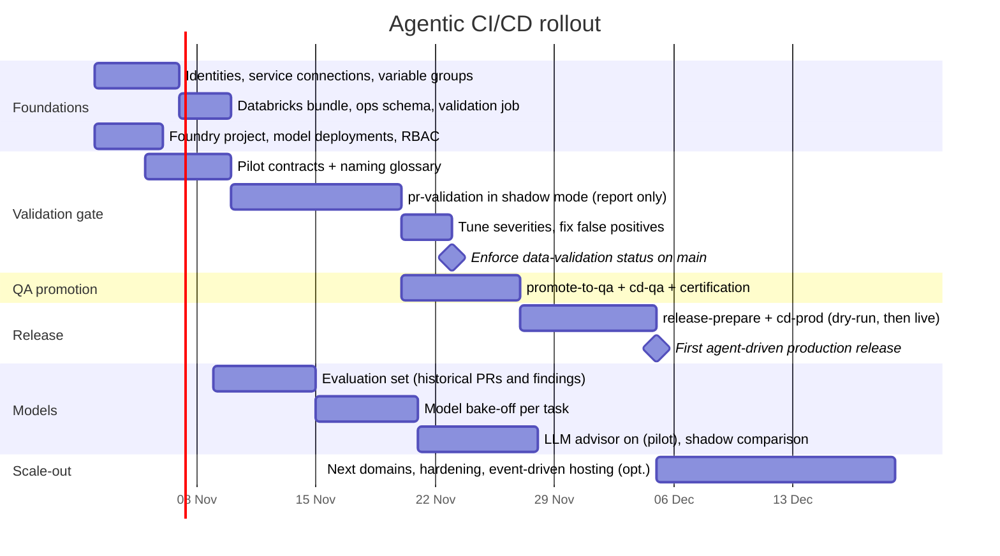

# Delivery Plan — Agentic CI/CD on Azure DevOps + Azure Databricks + Azure AI Foundry

| | |
|---|---|
| **Goal** | Code written in Azure Databricks reaches QA (`main`) and production (`release`) through Azure DevOps PRs, gated by three agents: Data Validation, QA Promotion, Release |
| **Agent framework** | LangGraph (agent workflows) + LangChain (model abstraction) |
| **Models** | Azure AI Foundry deployments (Claude, GPT, Mistral, Llama, …), switchable per task in config |
| **Duration** | 8 weeks to production, then scale-out per domain |
| **Related** | [HLD](HLD.md) · [LLD](LLD.md) · [Graphs](GRAPHS.md) · [Setup](SETUP.md) · [ADR 0005](adr/0005-langgraph-langchain-foundry.md) |

---

## 1. Principles that shape the plan

1. **Gates first, AI second.** The deterministic gates (validation rules, branch policies, certification, approvals) go live before any model is switched on. The LLM only adds explanations and can make a gate stricter, never looser.
2. **Shadow before enforce.** Every gate runs in report-only mode for at least one sprint before it blocks merges.
3. **Model-agnostic from day one.** Agents call LangChain chat models through a registry; which Foundry deployment does which task is configuration. Models are chosen by measured results on our own PRs, not by preference.
4. **Everything idempotent and audited.** Any pipeline can be re-run; every agent decision is in the audit table.

## 2. Workstreams

| # | Workstream | Scope | Lead role |
|---|---|---|---|
| WS1 | Platform foundations | Entra ID service principals, ADO service connections (workload identity), variable groups, Databricks workspaces/catalogs, Foundry project + RBAC | Platform engineer |
| WS2 | Data contracts & rules | Contracts for pilot domain, naming glossary, severity tuning, shift-left notebook | Data engineering lead + data owners |
| WS3 | Agents (LangGraph) | Data Validation, QA Promotion, Release flows; supervisor graph; ADO/Databricks tools | Agent developer |
| WS4 | Models (LangChain + Foundry) | Deploy candidate models, evaluation set, task→model routing, fallbacks, tracing | ML/AI engineer |
| WS5 | Pipelines & policies | 5 YAML pipelines, branch policies, environments + approvals | DevOps engineer |
| WS6 | Observability & audit | Audit/validation Delta tables, dashboards, Teams alerts, App Insights traces | Platform engineer |
| WS7 | Enablement | Developer guide, runbook, office hours, feedback loop | Data engineering lead |

## 3. Timeline



| Phase | Weeks | Exit criteria |
|---|---|---|
| **0. Foundations** | 1 | `agentic-devops --dry-run validate --pr-id <n>` works against the real org; `agentic-devops models --check` returns `ok` for every Foundry deployment; bundle deployed to dev/qa/prod |
| **1. Validation gate (shadow)** | 2–3 | `pr-validation` posts reports on every PR into `main` for the pilot domain; false-positive rate < 10 % after tuning |
| **2. Enforce + QA promotion** | 4 | `data-validation` and `qa-promotion` are required statuses on `main`; `cd-qa` certifies commits; developers promote from the Databricks notebook |
| **3. Release** | 5–6 | Dry-run releases match manual expectations; first production release via `release-prepare` → approvals → `cd-prod` → tag; rollback rehearsed in a game-day |
| **4. LLM advisor** | 5–7 (parallel) | Model per task chosen from evaluation results; advisor enabled for the pilot; ≥ 70 % of fix suggestions rated useful by engineers |
| **5. Scale-out** | 7–8+ | Second and third domains onboarded; dashboards in use; optional event-driven host |

## 4. Detailed backlog

| ID | Task | WS | Deliverable / acceptance | Depends on |
|---|---|---|---|---|
| F-1 | Create `sp-agentic-dev/qa/prod` and ARM service connections with workload identity federation | 1 | Pipelines log in to Azure without secrets | — |
| F-2 | Variable groups `agentic-devops-common/dev/qa/prod` (Key Vault-linked secrets) | 1 | All `${VAR}` in `config/agentic.yml` resolve | F-1 |
| F-3 | Deploy bundle to dev/qa/prod; run `setup_ops_tables` per catalog | 1 | Job `agentic-data-validation-<env>` exists; ids stored in variable groups | F-1 |
| F-4 | Repo permissions for Build Service (deny bypass/force push) | 1 | Permission matrix in SETUP §3.5 applied | — |
| F-5 | Foundry project; deploy candidate models; grant SPs **Azure AI User** on the project | 1/4 | `agentic-devops models --check` → all `ok` | F-1 |
| V-1 | Contracts for pilot tables (PK, columns, `sources`) | 2 | Every pilot table has a contract reviewed by its owner | — |
| V-2 | Agree naming glossary (`config/naming_standards.yml`) with data owners | 2 | Signed-off abbreviations, reserved words, type conventions | — |
| V-3 | `pr-validation` as *optional* build policy on `main` | 5 | Reports on all pilot PRs | F-3, V-1 |
| V-4 | Triage findings weekly; tune `severity_overrides`, `allow_fully_null` | 2 | FP rate < 10 % | V-3 |
| V-5 | Make `data-validation` status **required** | 5 | Failing data blocks merge | V-4 |
| Q-1 | `promote-to-qa` pipeline + Databricks notebook | 3/5 | Developer opens PR from Databricks in one click | F-2 |
| Q-2 | `cd-qa` with certification tags | 5 | `qa-certified/*` tag on every green QA deploy | F-3 |
| Q-3 | Branch policies on `main` (reviewers, work items, squash only, statuses) | 5 | Policies per SETUP §3.6 | V-5 |
| R-1 | `release-prepare` in `--dry-run` for two release cycles | 3 | Planned actions match release manager expectations | Q-2 |
| R-2 | `databricks-prod` environment approvals, business hours, exclusive lock | 5 | Prod deploy waits for approval | F-1 |
| R-3 | `cd-prod` with verify + rollback; rollback game-day | 3/5 | Rollback to previous tag in < 15 min | R-2 |
| R-4 | Branch policies on `release` (2 reviewers, release managers, `qa-certified`) | 5 | Only certified commits can merge | Q-2 |
| M-1 | Build evaluation set: ~40 historical PRs (validation findings, diffs, release notes) | 4 | `eval/` dataset with expected outcomes | V-3 |
| M-2 | Bake-off: each task × 2–4 Foundry models (see §5) | 4 | Scorecard; chosen model + fallback per task in config | M-1, F-5 |
| M-3 | Enable advisor for pilot; collect 👍/👎 on advisor notes | 4/7 | Usefulness ≥ 70 % | M-2 |
| M-4 | Tracing to Application Insights (`llm.tracing: azure_monitor`), cost dashboard | 4/6 | Tokens and latency per task visible | M-3 |
| O-1 | Dashboards: pass rate, top failing rules, lead time to prod | 6 | Shared Databricks SQL dashboard | Q-2 |
| E-1 | Developer guide, 30-min demo, runbook walkthrough | 7 | Recorded session, FAQ | V-3 |

## 5. Model strategy (LangChain + Azure AI Foundry)

**How switching works.** `config/agentic.yml` maps logical names to Foundry deployments and tasks to models:

```yaml
llm:
  project_endpoint: https://<resource>.services.ai.azure.com/api/projects/<project>
  models:
    claude:   {kind: foundry_anthropic, deployment: claude-opus-5-5}
    gpt:      {kind: foundry_openai,    deployment: gpt-4.1}
    gpt-mini: {kind: foundry_openai,    deployment: gpt-4.1-mini}
    mistral:  {kind: foundry_openai,    deployment: Mistral-Large-2411}
  tasks:
    remediation:        {model: claude,   fallbacks: [gpt], use_tools: true}
    pr_description:     {model: gpt-mini, fallbacks: [gpt]}
    release_assessment: {model: claude,   fallbacks: [gpt]}
```

Change a task's model by editing one line or setting `LLM_REMEDIATION_MODEL` / `LLM_PR_MODEL` / `LLM_RELEASE_MODEL` in the variable group — no code change, no redeploy of Databricks. A new model is one more entry under `models`. Models outside Foundry (e.g. Databricks Model Serving) can be added with `kind: langchain`.

**Candidate pairing to evaluate** (deployment names are examples; use what your Foundry project has):

| Task | Volume | What matters | Candidates |
|---|---|---|---|
| `remediation` (tool-using sub-agent) | per failing PR | reasoning over code + findings, reliable tool calling | Claude (Opus/Sonnet class), GPT-4.1, Mistral Large |
| `pr_description` | every promotion | concise writing, Conventional Commit titles, low cost/latency | GPT-4.1-mini, Claude Haiku class, Mistral Small |
| `release_assessment` | weekly | judgement, risk reasoning, structured output | Claude (Opus class), GPT-4.1 |

**Evaluation method (M-1/M-2).**

| Metric | How |
|---|---|
| Structured-output validity | % responses parsing into the Pydantic schema without fallback |
| Tool-use correctness (remediation) | did it read the right contract/file; rounds used |
| Usefulness | 2 engineers rate each suggestion 1–5 against a rubric (correct root cause, actionable snippet, no hallucinated columns) |
| PR title compliance | % Conventional Commit titles accepted (non-compliant ones fall back to templates) |
| Risk agreement | agreement with release manager's risk label; must never be *lower* than the rule floor (enforced anyway) |
| Latency p95 / cost per call | from App Insights traces / Foundry metrics |

Decision rule: pick the cheapest model within 5 % of the best usefulness score for each task; keep a fallback from a different model family. Re-run the bake-off when Foundry adds a model or quarterly.

## 6. Environments

| | Dev | QA | Prod |
|---|---|---|---|
| Branch | `feature/*` | `main` | `release` |
| Databricks workspace / catalog | dev / `dev` | qa / `qa` | prod / `prod` |
| Service principal | `sp-agentic-dev` | `sp-agentic-qa` | `sp-agentic-prod` |
| Validation | PR into `main` | certification, PR into `release` | post-deploy `schema_only` |
| Foundry | shared project (Entra ID per SP); optionally a separate prod project | | |

## 7. RACI

| Activity | Data engineer | Data eng. lead | Release manager | Platform/DevOps | Data owner |
|---|---|---|---|---|---|
| Contracts & glossary | R | A | I | C | C |
| PR review (`main`) | R | A | I | I | C |
| Release approval (`release` + prod env) | I | C | A/R | C | I |
| Pipelines, policies, identities | I | C | C | A/R | I |
| Model selection & prompts | I | C | C | R | I |
| Incident / rollback | C | R | A | R | I |

## 8. Success metrics

| KPI | Baseline | Target (3 months) |
|---|---|---|
| PRs into `main` with automated data validation | 0 % | 100 % (onboarded domains) |
| Data defects found in QA/prod that the rules cover (dup PK, all-NULL column, naming) | measure in phase 1 | −80 % |
| Lead time `promote-qa` → production | measure | −30 % |
| Releases outside change window | measure | 0 |
| Validation false-positive rate | — | < 5 % |
| Advisor suggestions rated useful | — | ≥ 70 % |

## 9. Risks

| Risk | Likelihood | Impact | Mitigation |
|---|---|---|---|
| Teams see the gate as friction | M | H | Shadow phase, shift-left notebook, actionable fixes in every finding, fast triage of false positives |
| Dev data too small/unrepresentative | M | M | Second validation on QA data before release; contract `min_rows` |
| A Foundry model is retired or throttled | M | L | Fallback model per task from another family; switch is config-only; gates never depend on LLM |
| Model quality varies by task | M | L | Per-task routing chosen by evaluation, re-evaluated quarterly |
| Sensitive data sent to a model | L | H | Metadata only by default (`share_sample_values: false`); in-tenant Foundry with Entra ID; content recording off in traces |
| Over-privileged agent identity | L | H | Deny bypass/force-push; prod SP limited to `cd-prod`; quarterly access review |
| Contract upkeep burden | M | M | Schema-contract findings tell owners exactly what drifted; contracts reviewed in the same PR as code |

## 10. This week's next steps

1. Platform: create the three service principals and service connections (F-1), and the Foundry project with two model deployments (F-5).
2. Data engineering lead: pick the pilot domain and draft contracts for its tables (V-1).
3. DevOps: fill variable groups, deploy the bundle to dev (F-2, F-3), run `agentic-devops --dry-run validate --pr-id <recent PR>`.
4. AI engineer: run `agentic-devops models --check`, start the evaluation set (M-1).
